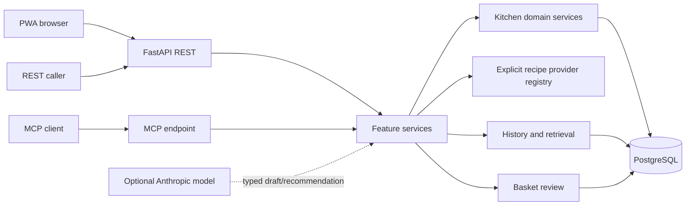

# Architecture

Reviewed 2026-11-15. This document describes the public application source and its implemented boundaries. Private deployment details are maintained separately.

## Runtime shape

`app.py` composes FastAPI, the kitchen service, history, feature routes, the basket service, and FastMCP. REST and MCP transports call the same application and domain services for their corresponding operations. The browser PWA uses the REST API. FastAPI serves the OpenAPI document at `/openapi.json`, interactive API docs at `/docs`, the PWA under `/`, and the MCP transport at `/mcp/`.

The system is not a checkout integration. Kitchen calculates and reviews data; a person makes the save, product-selection, or external purchase decision.

## Storage and transactions

Runtime storage is PostgreSQL through SQLAlchemy and the `psycopg` driver. `KITCHEN_DATABASE_URL` is a required secret setting and must use `postgresql+psycopg`. SQLite is not supported. Alembic migrations define the normalized recipe, meal, item, regular-item, confirmation, and settings tables, then add history and basket-selection tables. Run migrations with `uv run python -m alembic upgrade head` before starting the service.

Recipe ingredients, instructions, household interaction structure, and saved basket selections use JSONB where appropriate. History search uses a generated PostgreSQL `tsvector` over the message and structured JSON text with a GIN index. `KnowledgeRetriever` is the replaceable retrieval boundary; the current implementation uses PostgreSQL full-text search. There is no vector index, embedding pipeline, or embedding charge.

`Store.save` writes a domain entity and its corresponding history event in one PostgreSQL transaction. Basket selection and removal similarly persist the selection change and its domain event in one transaction. These guarantees apply to those paths; they do not imply that every application operation automatically creates an event or that external effects share a database transaction.

## Recipes and meal planning

Recipe acquisition uses an explicit `RecipeProvider` protocol and registry. The current adapters are:

- `manual`, which validates a supplied recipe;
- `web`, which imports supported public Matprat, Marmiton and Oda pages into a draft; and
- `ai`, which uses an explicitly configured Anthropic model to adapt a supplied source recipe, URL or prior draft. Prompt-only generation is rejected.

Provider drafts are typed and marked `requires_review`. They do not write to the recipe store. A person reviews a draft and saves it through the recipe API. Imported ingredient text is retained for review instead of guessing missing quantities. A recipe can have an optional HTTPS `image_url` from an imported source or a person. An image URL returned as part of AI output is unverified and must be checked before saving. Kitchen does not create placeholder or generated recipe photos.

The weekly planner receives household settings, the requested date range, the recipe catalog, and selected retrieved evidence. Its typed result contains proposed meals, notes, and evidence IDs. It can only refer to recipes in the supplied catalog; dates, servings, and duplicate slots are validated. The result is still a draft. The user saves individual meals deliberately. No recipe or meal is written as a side effect of model generation.

Reviewable meal plan proposals (`home_kitchen.planning`) establish the application's incremental vertical slice convention:
- **Interfaces**: REST routes (`/api/plan-proposals`) and FastMCP tools (`create_plan_proposal`, `confirm_plan_proposal`) invoke application services without direct storage coupling.
- **Application**: `PlanningProposalService` coordinates input bounds, recipe state fingerprinting, expiry checks, and atomic confirmation workflows.
- **Domain and Ports**: Pure models (`ProposalRead`), exceptions (`ProposalConflict`, `ProposalExpired`), and invariants (`fingerprint_recipe`, `validate_proposal_bounds`) define the core rules; explicit Protocols (`ProposalRepository`, `RecipeReader`, `MealWriter`, `HistoryRecorder`, `PlanningUnitOfWork`) define secondary port contracts.
- **Adapters**: Secondary adapters implement the ports (`PostgresPlanningUnitOfWork` with row-level locks and transactional savepoints; `MemoryPlanningUnitOfWork` for pure in-memory unit tests without database or network dependencies).
- **Bootstrap**: Factory wiring (`create_planning_proposal_service`) connects storage adapters to application services during feature composition.

AI configuration is optional and uses `KITCHEN_AI_MODEL` plus `KITCHEN_ANTHROPIC_API_KEY`. Without both, the AI endpoints return a setup response. Automated tests use controlled model doubles; they do not prove live Anthropic connectivity, current model behavior, or operating cost.

## Shopping needs and basket review

The shopping service combines scaled ingredients from planned meals with open quick additions and eligible regular items. A regular-item suggestion remains separate until the household confirms it. The distinct regular-item purchase action records a purchase date; checking off a quick addition does not assert that an item was purchased.

Basket review converts those aggregate shopping lines into stable need records for a date range. A need describes the quantity and unit Kitchen calculates. A selected product is a separate provider snapshot with exact name, brand, URL, image URL, pack size, package count, price/currency, availability, observation time, evidence status, and alternatives. Deterministic evaluation calculates allocated, remaining, and overbuy quantities and flags missing quantity, stale or future-dated evidence, unverified data, unknown availability, unknown prices, and currency mismatches.

A `ProductProvider` protocol and registry define a future search/verification adapter. Oda OAuth/MCP product search and cart inspection remain read-only. For image enrichment, Kitchen fetches only a validated public Oda product-page URL and accepts explicit existing image references when the page identifies the exact requested product; it does not construct image URLs or infer package quantities. This public page enrichment is not product or fulfillment verification. Candidate selections submitted through the basket API/MCP remain forcibly `unverified`, including alternatives.

Cart additions use a separate review flow. Kitchen searches for the requested products, reads and fingerprints the current cart, and persists a short-lived proposal scoped to the authenticated actor and Oda connection generation. The proposal displays exact positive package additions and their warnings. Explicit confirmation claims the proposal in a transaction before any remote write; actor-level serialization and the persisted `attempted` state prevent replay. Confirmation reads the cart again and sends additions only if its fingerprint is unchanged. If the remote outcome is uncertain, Kitchen records that state and never retries the write. This path changes cart contents only; checkout and payment remain with the user at Oda. The implementation has mocked protocol tests; live Oda OAuth and cart-write acceptance remain unverified.

The word “ready” means the deterministic review checks passed for the submitted snapshots; it is not authorization to check out, an assurance of correctness, or proof that a merchant still has the product.

## Explicit history and recommendation context

`HistoryRepository` stores caller-selected messages plus structured JSON, channel (`app`, `api`, or `mcp`), kind, occurrence time, and optional recipe/session identifiers. Request authentication may provide actor context; verify that integration before relying on attribution. The API does not copy an external conversation automatically. MCP recording is an explicit tool call with instructions to preserve only context the user wants remembered.

History kinds include feedback, preference, recipe rating, purchase, planning, domain event, and explicitly supplied chat excerpts. Search is bounded PostgreSQL full-text retrieval. AI recipe and meal-plan context can include recent preferences, feedback, ratings, and purchases as well as text matches. Retrieved entries are untrusted context, not instructions. Evidence IDs identify stored records supplied to the model; they are not independently checked citations and do not prove a claim.

The retrieval interface can support a future alternative such as vector search, but the current implementation does not compute embeddings or imply a cost or quality benefit from them.

## HTTP feature routes

The complete request and response schemas are generated in `/openapi.json`; `/docs` presents the current interactive reference. The main feature routes are:

| Route | Purpose |
| --- | --- |
| `GET/POST /api/catalogue/foods/{food_id}/products` | Read or remember exact household SKU options; selection never means preference or purchase. |
| `PUT/DELETE /api/catalogue/products/{option_id}/preferred` | Change an explicit exact-product preference. |
| `GET /api/store-trip/completion-review` | Review actual quantities and traced quick-add/regular sources before confirming purchase. |
| `POST /api/store-trip/completions` | Atomically record confirmed actual purchases with idempotency and selective source reconciliation; no stock inference. |
| `GET /api/catalogue/foods?q=…` | Find distinct, source-attributed generic food vocabulary; no household behavior is inferred. |
| `POST /api/recipe-discovery` | Find genuine source links with explicit independent provider statuses. |
| `GET /api/meals/{meal_id}/recipe` | Read planned-serving ingredients alongside the unchanged saved source recipe. |
| `GET /api/basket/matches?start=…&end=…` | Read bounded candidate products, images, alternatives and package estimates for net needs; never select or buy. |
| `GET /api/recipe-providers` | List registered recipe draft adapters and their accepted inputs. |
| `POST /api/recipe-drafts/{provider_id}` | Request a typed manual, web, or AI recipe draft for review. |
| `POST /api/ai/recipe` | Compatibility route for an AI recipe draft; it never saves the result. |
| `POST /api/ai/plan` | Generate a reviewable weekly plan draft from the recipe catalog. |
| `GET /api/basket?start=…&end=…` | Review calculated needs and current product selections. |
| `PUT /api/basket/selections` | Save a candidate product snapshot for a need; it remains unverified. |
| `DELETE /api/basket/selections/{need_id}/{product_id}?start=…&end=…` | Remove a saved candidate selection. |
| `POST /api/interactions` | Explicitly save one caller-provided history entry. |
| `POST /api/recipes/{recipe_id}/feedback` | Save a typed rating, would-make-again answer, or note for an existing recipe. |
| `GET /api/interactions` | List recent saved history entries. |
| `GET /api/knowledge/search?query=…` | Search recorded history and return evidence records. |

The existing recipe, meal, shopping-list, regular-item, and household routes are also described by OpenAPI. The `/api/recipe-import`, `/api/ai/recipe`, and `/api/ai/plan` endpoints return drafts; persistence occurs only through an explicit save route.

## Authentication and local development

Settings are loaded from `KITCHEN_`-prefixed environment variables. `KITCHEN_DATABASE_URL` is always required. Local development requires `KITCHEN_LOCAL_DEV=true` and is accepted only when the request peer is loopback. Otherwise startup requires Entra tenant, audience, and allowed-group configuration. Forwarded proxy headers are disabled in Uvicorn by default; a deployment must explicitly configure trusted proxy networks before relying on identity headers from a proxy.

Remote MCP optionally uses the encrypted PostgreSQL-backed Entra OAuth broker. Enable it with its independent signing/encryption keys and canonical public URL; private deployment manifests own ingress. Discovery and authentication challenge checks do not establish successful phone-client login, which remains a separate acceptance test.

## Current limits and decisions to revisit

- Oda OAuth and cart-write behavior has mocked tests only and requires live acceptance testing; no product verifier, checkout, or order submission is enabled.
- AI requires an operator-configured model and credential. No live provider test is implied by unit tests or generated content.
- Product candidates remain unverified unless a future authenticated provider verification path is implemented and independently tested.
- PostgreSQL persistence requires an operational backup and restore path before production-readiness claims.
- External recipe websites, image URLs, and model services can change or fail independently of Kitchen.

## Shopping plan, stock and purchase modes

`InventoryService` combines the gross `ShoppingBuilder` result with explicit PostgreSQL stock records. Each line retains required, available, covered and net quantities. Fully covered lines stay visible in the plan and are excluded from both the Oda basket and in-store checklist. No unit conversion or consumption is inferred. `PurchaseModes` is a registry of purchase adapters; each mode uses this shared plan. Categories are household-supplied on ingredients, quick captures, regulars and stock, with `Other` as fallback.

`StoreTripService` stores picking progress independently by period and stable need ID. It compares the checked quantity with the current net requirement, so adding quantities does not silently mark them picked. History records these as domain events, not purchases.

Additional routes: `GET /api/purchase-plan`, `GET /api/purchase-modes`, `GET|PUT /api/inventory`, `DELETE /api/inventory/{id}`, `GET /api/store-trip`, and `PUT /api/store-trip/items/{need_id}`. Their MCP counterparts use the same services.

## Direct Oda OAuth

`OdaService` owns discovery, dynamic client registration on an explicit Connect request, ten-minute actor-bound single-use state, PKCE S256, token exchange, serialized refresh and revocation. State payloads and tokens are encrypted with a Fernet key injected through `KITCHEN_ODA_ENCRYPTION_KEY` before reaching PostgreSQL. The browser receives an authorization URL and static callback success/failure redirects, never tokens. `KITCHEN_PUBLIC_URL` must be an HTTPS origin. The callback remains behind household authentication; reverse-proxy and app access logs must exclude its query parameters.

`GET /api/oda/status`, `POST /api/oda/connect`, `GET /api/oda/callback`, and `DELETE /api/oda/connection` manage connection lifecycle. `POST /api/oda/products/search` and `GET /api/oda/cart` expose a fixed read-only tool allowlist and validate the provider's tool annotations/schema. `POST /api/oda/products/media` accepts only an exact public Oda product-page URL and extracts matching JSON-LD media; `POST /api/oda/cart/proposals` creates a review, `GET /api/oda/cart/proposals/{id}` reads it, and `POST /api/oda/cart/proposals/{id}/confirm` requires explicit review before a single-use cart update. There is no generic MCP tool proxy. Oda's official product schema has no image or numeric package-size field; page enrichment uses only source-provided image URLs and explicit size descriptions, retaining unknowns. Live registration, consent, refresh, and authenticated remote calls remain acceptance gates.

`GET /api/oda/orders` and MCP `list_oda_orders` read one actor-scoped provider page at a time (`page` 1–50, `size` 1–20; defaults 1 and 20). `GET /api/oda/orders/{order_number}/tracking` and MCP `track_oda_order` inspect an exact order number and preserve its provider lifecycle status, including unknown future values without interpreting them as purchase completion. These read-only surfaces reuse the validated Oda service contracts; they neither change the cart nor sync orders into Kitchen purchase evidence, household history or inventory. An order, delivery date or even `delivered` status does not establish final receipt contents or payment evidence.

The fixture-tested Oda source reader uses an opaque, versioned full-rescan cursor containing actor, scan generation, next page and completion state. Each completed or capped scan restarts at page one on the next poll. Page-50 truncation saves available source records and reports an incomplete scan; this is not incremental completeness. Missing provider update timestamps remain null. No scheduler or automatic purchase-evidence ingestion is enabled.

## Trumf receipt reading spike

The read-only, fixture-backed Trumf receipt history reader adapter normalizes provider transaction lists and detailed receipt line items from Next.js App Router RSC flight payloads (`www.trumf.no/trumf-profil/kvitteringer`). It extracts batch ID, transaction timestamp, store description, chain, receipt presence (`hasReceipt`), line items (product name, quantity, unit, amount, VAT), and savings/discount metadata. Unknown EAN barcodes remain nullable and are never inferred as exact identities. Missing or invalid RSC flight data raises authentication errors rather than assuming an empty history. Transactions without line-item receipt evidence preserve provider presence while explicitly recording `hasReceipt=False`; these rows are never promoted to confirmed kitchen purchases, stock, or recipe completions.

The adapter uses an opaque, bounded full-rescan cursor (`trumf-scan-v1.*`) capped at 50 pages, with idempotent deduplication via deterministic SHA-256 payload revision hashing. Trumf retains at most the last 12 months of purchase history, and unattended refresh is not currently supported (live connector access requires manual session cookies). No credentials, session cookies, or live network calls are part of this spike.
